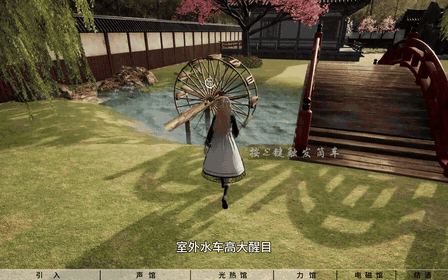
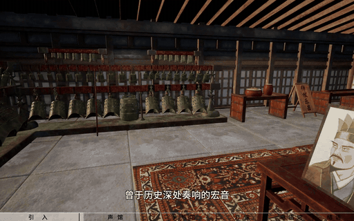
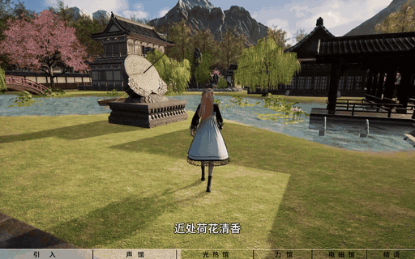
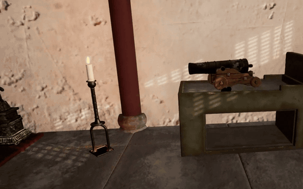
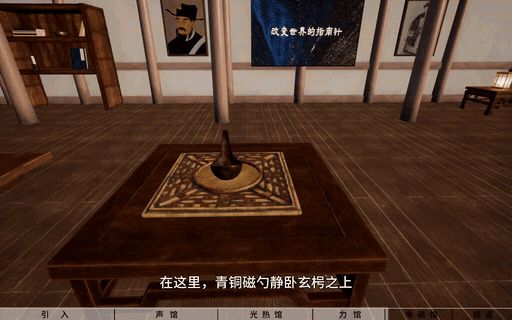
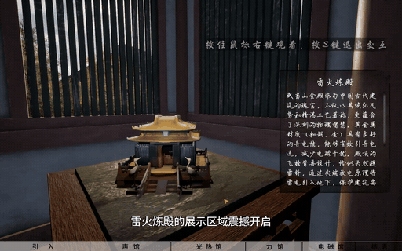
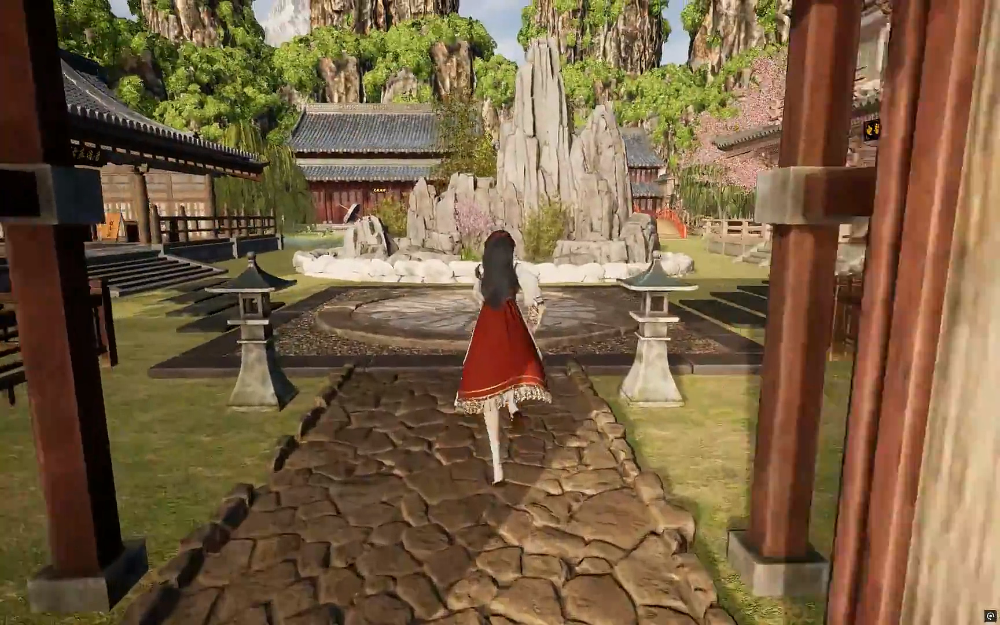
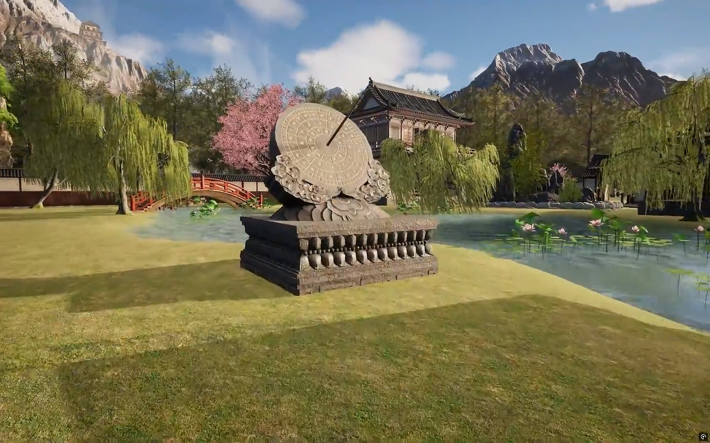
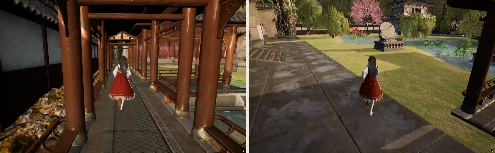
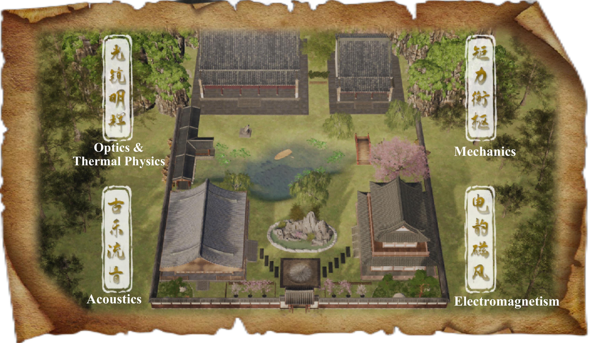

# Ancient Chinese Physics Experience Park

An interactive 3D learning environment for exploring ancient Chinese physics through historical instruments and hands-on exhibits in Unreal Engine.

**2nd Place (National Second Prize)** · Digital Media Games and Interaction Track · Chinese Collegiate Computing Design Competition · August 2025

I independently designed and built the project as the team's sole technical developer. I created the 3D assets and levels, programmed exhibit interactions, produced the visual and audio elements, and packaged the application for the competition.

**Full competition demo** · [Download the original recording](https://github.com/SuyuanYY/ancient-chinese-physics-3d/releases/download/v1.0/ancient-chinese-physics-full-demo.mp4) (5 min 23 sec).

## Project previews

### Waterwheel and Garden Walkthrough

Walk through the garden, inspect a waterwheel exhibit, and cross the footbridge.

<picture>
  <source type="image/avif" srcset="waterwheel-and-garden.avif">
  
</picture>

### Bianzhong (Chinese Chime Bells)

Approach the chime-bell rack and strike individual bells in the Sound Gallery. This exhibit starts at 1:13 in the full video.

<picture>
  <source type="image/avif" srcset="bianzhong-chime-bells.avif">
  
</picture>

### Courtyard Sundial

Approach the stone sundial and switch to a close-up view of its dial and exhibit notes.

<picture>
  <source type="image/avif" srcset="courtyard-sundial.avif">
  
</picture>

### Gunpowder Exhibit

View a 3D model of a historical cannon and its in-game ignition effect.

<picture>
  <source type="image/avif" srcset="gunpowder-exhibit.avif">
  
</picture>

### Sinan Compass

Rotate the spoon in an interactive model of a traditional Chinese compass.

<picture>
  <source type="image/avif" srcset="sinan-compass.avif">
  
</picture>

### Lightning at the Golden Hall

View a lightning demonstration around a model of the Golden Hall on Wudang Mountain.

<picture>
  <source type="image/avif" srcset="golden-hall-lightning.avif">
  
</picture>

## Chinese Garden Design (Selected Examples) / 中式园林设计思想（部分）

The environment brings classical Chinese garden ideas into an interactive learning space, combining framed views, water, corridors, and exhibition halls.

### 1. Entrance Rockery / 开门见山，先藏后露

A rockery partly hides the courtyard at the entrance, revealing the garden as visitors walk around it.

<picture>
  <source type="image/avif" srcset="assets/garden-design/entrance-rockery.avif">
  
</picture>

### 2. Mountain Backdrop and Open Water / 远山围合，近水开敞

An open pond creates space in the foreground, with waterside buildings and distant mountains shaping the view.

<picture>
  <source type="image/avif" srcset="assets/garden-design/waterside-and-mountains.avif">
  
</picture>

### 3. Changing Views Along the Path / 曲径连廊，移步换景

Winding paths and connected corridors reveal different views of the courtyard as visitors move through the garden.

<picture>
  <source type="image/avif" srcset="assets/garden-design/changing-views.avif">
  
</picture>

### 4. Interactive Map Navigation / 地图导航

The in-game map helps visitors find the four exhibition halls and jump to their entrances.

<picture>
  <source type="image/avif" srcset="assets/garden-design/interactive-map.avif">
  
</picture>

## Related research

The competition build later served as the starting point for a separate graduate research collaboration on state-grounded question answering.

In this demo, the in-scene AI assistant introduces the *sheng*, a traditional Chinese wind instrument, based on the exhibit the learner is viewing. The learner then asks how the instrument produces sound.

<picture>
  <source type="image/avif" srcset="state-grounded-qa-demo.avif">
  
</picture>
