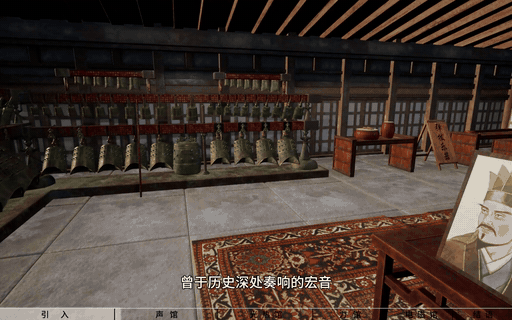
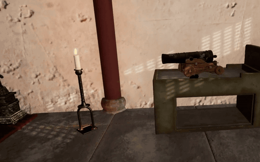
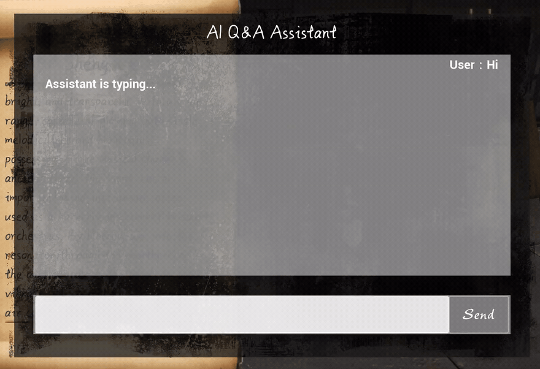

# Ancient Chinese Physics Experience Park

An interactive 3D learning environment for exploring ancient Chinese physics through historical instruments and hands-on exhibits in Unreal Engine.

**2nd Place (National Second Prize)** · Digital Media Games and Interaction Track · Chinese Collegiate Computing Design Competition · August 2025

I independently designed and built the project as the team's sole technical developer. I created the 3D assets and levels, programmed exhibit interactions, produced the visual and audio elements, and packaged the application for the competition.

**Full competition demo** · [Download the original recording](https://github.com/SuyuanYY/ancient-chinese-physics-3d/releases/download/v1.0/ancient-chinese-physics-full-demo.mp4) (5 min 23 sec).

## Project previews

### Waterwheel and Garden Walkthrough

Walk through the garden, inspect a waterwheel exhibit, and cross the footbridge.

### Bianzhong (Chinese Chime Bells)

Approach the chime-bell rack and strike individual bells in the Sound Gallery. This exhibit starts at 1:13 in the full video.

### Courtyard Sundial

Approach the stone sundial and switch to a close-up view of its dial and exhibit notes.

### Gunpowder Exhibit

View a 3D model of a historical cannon and its in-game ignition effect.

### Sinan Compass

Rotate the spoon in an interactive model of a traditional Chinese compass.

### Lightning at the Golden Hall

View a lightning demonstration around a model of the Golden Hall on Wudang Mountain.

## Related research

The competition build later served as the starting point for a separate graduate research collaboration on state-grounded question answering.

In this demo, the in-scene AI assistant introduces the *sheng*, a traditional Chinese wind instrument, based on the exhibit the learner is viewing. The learner then asks how the instrument produces sound.

